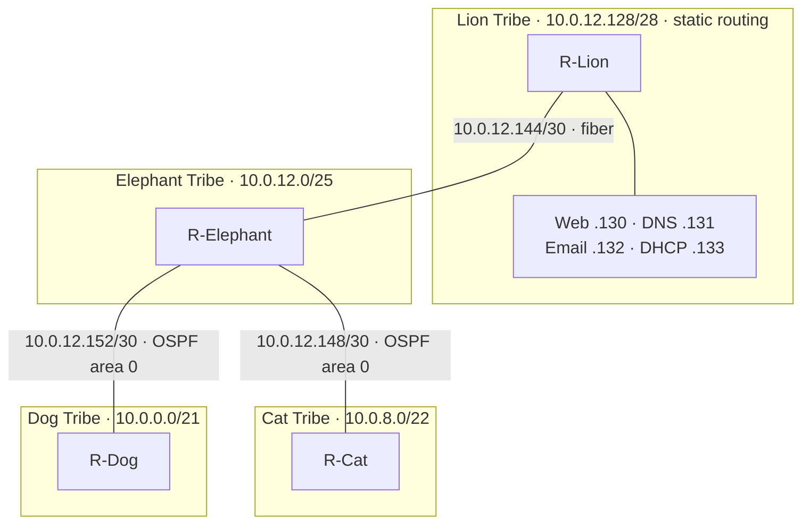
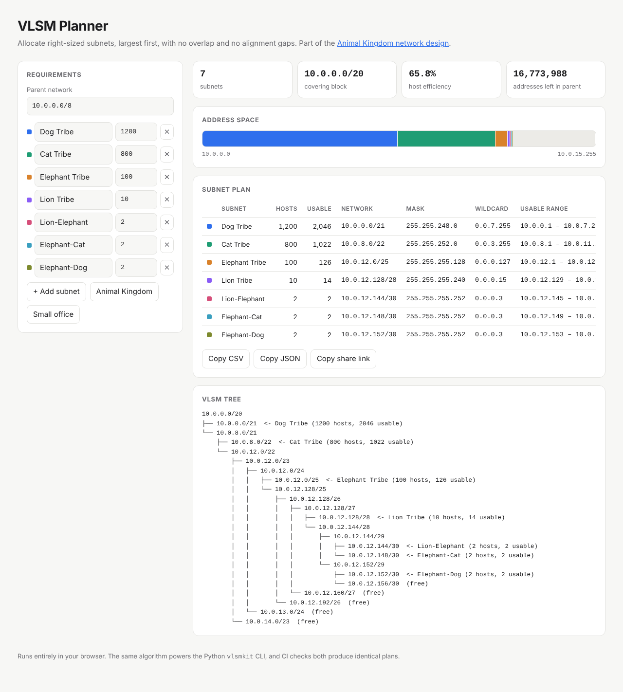
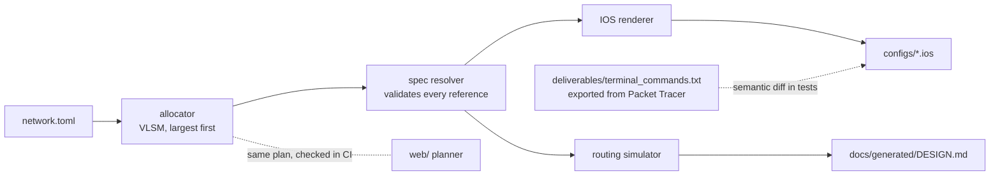
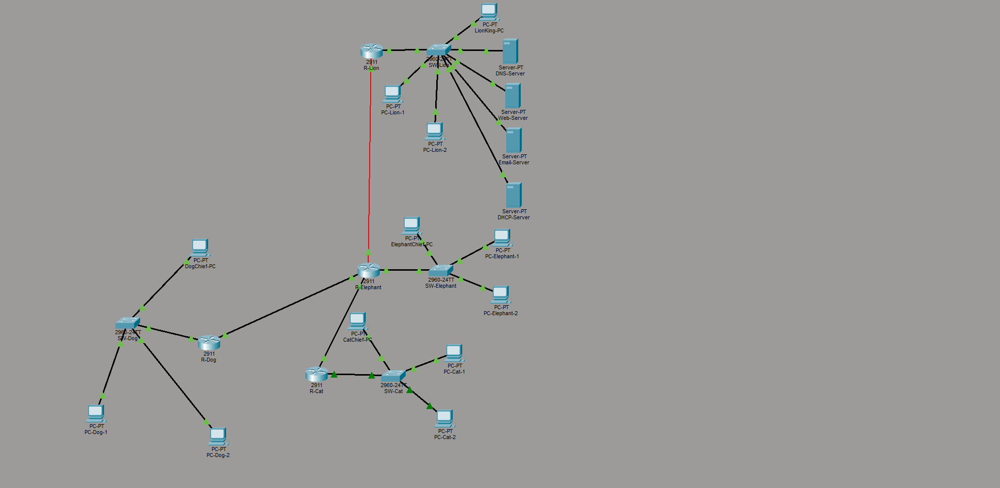

# Animal Kingdom Network Design (VLSM)

[](https://github.com/roy032/network-design-vlsm/actions/workflows/ci.yml)


[](LICENSE)

An enterprise-style network for a fictional **Animal Kingdom** of four tribes, built in
**Cisco Packet Tracer** and backed by **design-as-code**: one spec file
([`network.toml`](network.toml)) generates the addressing plan, every router config and the
documentation tables, and a routing simulator proves in CI that every tribe can reach every
other tribe.



| Tribe | Hosts | Subnet | Routing |
|---|---:|---|---|
| Dog | 1200 | 10.0.0.0/21 | OSPF |
| Cat | 800 | 10.0.8.0/22 | OSPF |
| Elephant | 100 | 10.0.12.0/25 | OSPF, plus a static route to Lion redistributed into OSPF |
| Lion | 3 PCs + 4 servers | 10.0.12.128/28 | Static only |

Services: centralized **DHCP** (relayed by each tribe's router), **DNS** for `animals.com`,
a **web server** at `www.animals.com` and **email** between the tribe chiefs.

## Highlights

- **Design as code.** [`network.toml`](network.toml) is the single source of truth. `vlsmkit build`
  generates [`configs/*.ios`](configs) and [`docs/generated/DESIGN.md`](docs/generated/DESIGN.md);
  CI fails if anything is hand-edited or stale.
- **Verified against the as-built lab.** Tests parse the configs exported from Packet Tracer
  ([`deliverables/terminal_commands.txt`](deliverables/terminal_commands.txt)) and assert the
  generated configs are semantically identical: same interfaces, addresses, OSPF networks,
  passive interfaces, static routes and redistribution.
- **Routing simulator.** Builds each router's routing table (connected, static, OSPF with
  passive interfaces and redistribution, administrative distance, longest prefix match) and
  traces round-trip pings between every pair of subnets. It catches black holes and loops
  before anything is cabled.
- **Interactive web planner.** A zero-dependency VLSM calculator ([`web/`](web)) with an
  address-space map, VLSM tree and shareable links. Node tests check it produces exactly the
  same plan as the Python engine.
- **Engineering hygiene.** Strict mypy, ruff, property-based tests with Hypothesis, ≥95%
  branch coverage enforced, Python 3.11 to 3.13 CI matrix, wheel build smoke test, Dependabot
  and pre-commit hooks.



## Quick start

```bash
pip install -e ".[dev]"      # or: make install

vlsmkit plan 10.0.0.0/8 Dog=1200 Cat=800 Elephant=100 Lion=10 --format tree
vlsmkit build                # regenerate configs/ and docs/generated/ from network.toml
vlsmkit check                # CI gate: generated files current + all LANs reachable
vlsmkit ping 10.0.0.2 10.0.12.130   # simulate DogChief-PC -> Web-Server
vlsmkit routes R-Cat         # simulated `show ip route`

make all                     # lint + type-check + Python/JS tests + design check
make serve                   # web planner at http://localhost:8000
```

Example output:

```text
$ vlsmkit ping 10.0.0.2 10.0.12.130
request: R-Dog -> R-Elephant -> R-Lion => 10.0.12.130: delivered
reply:   R-Lion -> R-Elephant -> R-Dog => 10.0.0.2: delivered

$ vlsmkit routes R-Cat
O    10.0.0.0/21 via 10.0.12.149
C    10.0.8.0/22 directly connected
O    10.0.12.0/25 via 10.0.12.149
O E2 10.0.12.128/28 via 10.0.12.149
C    10.0.12.148/30 directly connected
O    10.0.12.152/30 via 10.0.12.149
```

## How it fits together



| Module | Responsibility |
|---|---|
| [`allocator.py`](src/vlsmkit/allocator.py) | Smallest prefix per request, largest-first aligned allocation, overflow detection |
| [`spec.py`](src/vlsmkit/spec.py) | Loads `network.toml`, resolves `host = N` offsets and next-hop routers, reports *all* problems at once (duplicate IPs, unknown subnets, static hosts inside DHCP pools, missing gateways and more) |
| [`ios.py`](src/vlsmkit/ios.py) | Renders paste-ready IOS and parses IOS back for semantic comparison |
| [`routing.py`](src/vlsmkit/routing.py) | Control-plane simulation and hop-by-hop packet tracing |
| [`report.py`](src/vlsmkit/report.py) | VLSM tree, Markdown tables, JSON |
| [`cli.py`](src/vlsmkit/cli.py) | `plan`, `build`, `check`, `ping`, `routes` |

## Design review findings

Building the verifier surfaced issues in the original hand-written material. All of them are
now fixed or documented, and tests guard against regressions.

1. **The VLSM tree diagram was mathematically wrong.** It jumped from `10.0.0.0/12` to `/20`
   and drew `10.0.8.0/22` as a child of `10.0.0.0/21`. Both tree diagrams are now generated.
2. **Docs disagreed with the as-built lab.** The docs said the Lion-Elephant link used `Gi0/0`
   and the Elephant LAN used `Gi1/0`; the Packet Tracer file uses `Gi0/0/0` (fiber) and `Gi0/0`.
   All docs were corrected, and `tests/test_docs.py` now checks the IP table against the spec.
3. **Open finding: the Lion-Elephant link (10.0.12.144/30) is not advertised into OSPF.**
   Every LAN reaches every LAN, but Cat and Dog cannot ping R-Lion's or R-Elephant's link
   addresses, which makes troubleshooting harder. The fix is one line on R-Elephant,
   `redistribute connected subnets` under `router ospf 1`. A test proves this closes the gap.
   It is not applied here so the configs keep matching the submitted `.pkt` file.

## Repository layout

```text
├── network.toml              # single source of truth for the design
├── src/vlsmkit/              # planner, config generator, routing simulator, CLI
├── tests/                    # pytest + Hypothesis (allocator, spec, IOS, routing, CLI, docs)
├── configs/                  # GENERATED router configs, ready to paste
├── docs/
│   ├── generated/            # GENERATED design doc and plan.json
│   └── *.md                  # step-by-step build guides and explanations
├── web/                      # static VLSM planner (deployed to GitHub Pages)
└── deliverables/             # Packet Tracer file, topology image, as-built CLI export
```

## Opening the lab

1. Install [Cisco Packet Tracer](https://www.netacad.com/courses/packet-tracer).
2. Open [`deliverables/project.pkt`](deliverables/project.pkt).
3. Use [`docs/Complete_Step_By_Step_Guide.md`](docs/Complete_Step_By_Step_Guide.md) to rebuild
   it from scratch, pasting configs from [`configs/`](configs).



## Contributing

See [CONTRIBUTING.md](CONTRIBUTING.md). In short: edit `network.toml`, run `make build`,
then `make all`, and commit the regenerated files with your change.
